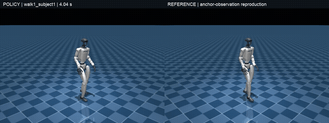
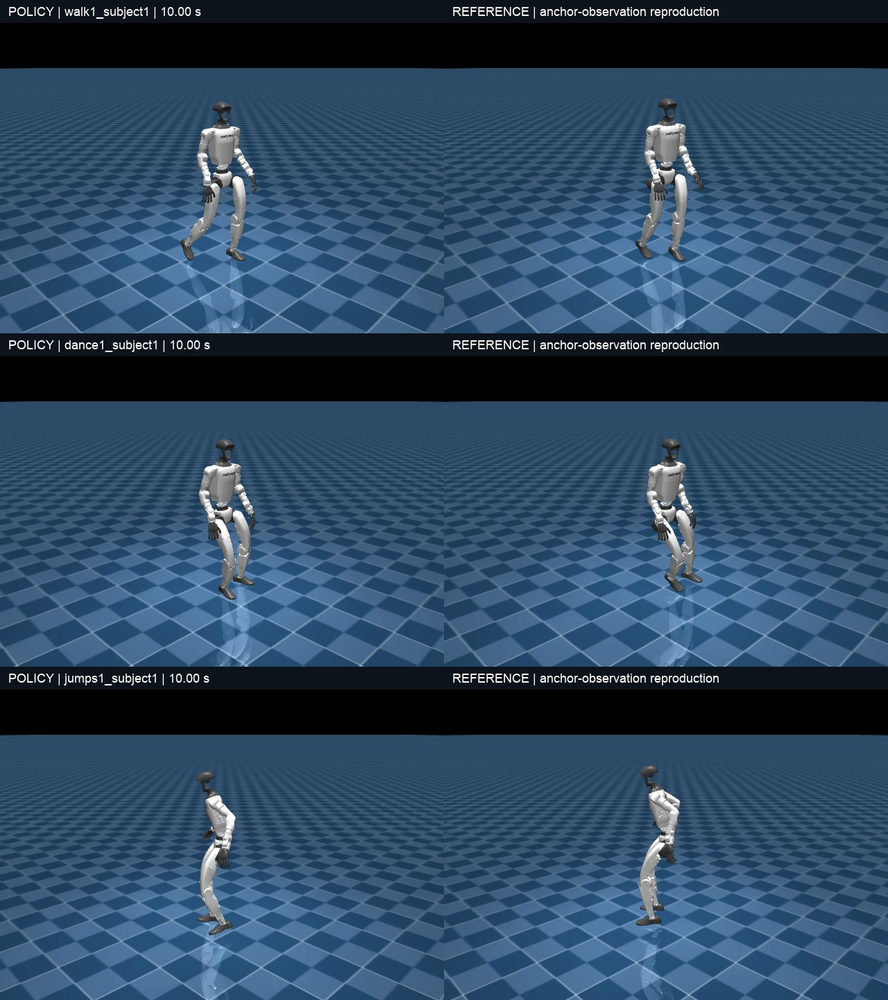
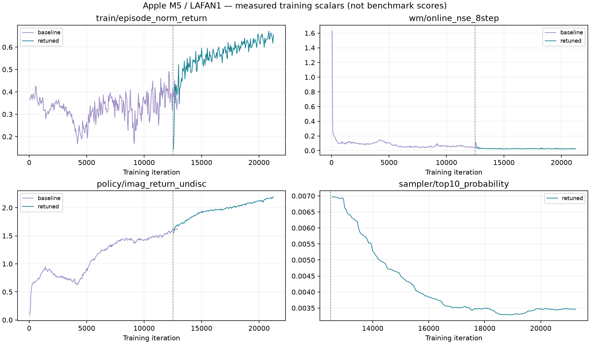

# SuperMimic on Apple M5

**在一台 M5 MacBook 上，从零训练 Unitree G1 全身动作跟踪。**

基于 [SuperMimic-Reproduced](https://github.com/CuboiLeo/SuperMimic-Reproduced) 的 macOS 适配与实测记录。使用全部 **40 条 LAFAN1** 动作；**MPS 负责学习，CPU 负责物理仿真**。提供固定版本环境、自动数据准备、预训练模型、完整评测、训练曲线和真实仿真视频。

> **English.** A measured Apple M5 reproduction of SuperMimic: PyTorch MPS learning with CPU MuJoCo physics, all 40 LAFAN1 clips, a published checkpoint, videos and per-clip results. Trained from scratch on this Mac in two stages; no NVIDIA-trained weights. Uses anchor-relative observations, not a paper-identical benchmark. [English quick start](docs/QUICKSTART_EN.md).

## 看效果



[](assets/videos/mac-lafan1-21000-preview.mp4)

**[▶ 60 秒合集](assets/videos/mac-lafan1-21000-preview.mp4)** · [行走](assets/videos/walk1_subject1.mp4) · [舞蹈](assets/videos/dance1_subject1.mp4) · [跳跃](assets/videos/jumps1_subject1.mp4) · [模型下载](https://github.com/WXyuany/supermimic-m5/releases/tag/v0.1.0)

左侧为策略控制的物理仿真，右侧为参考动作。三段预览各 20 秒，均使用 **21000 次**模型，不代表完整动作都成功。两侧镜头分别跟随机器人；绝对位置误差请结合评测查看。GitHub 若不内嵌播放 MP4，可点击文件页下载按钮。

## 实验结果

设备：**Apple M5 MacBook / 24 GB / macOS 27.0**。仅单次 seed 0 实验，全部动作同时用于训练和跟踪评测。

| 检查点 | 全 40 条平均回报 ↑ | 按执行步数加权 ↑ | 完整完成 | 提前终止 |
|---|---:|---:|---:|---:|
| 基线 12500 | 0.5364 | 0.5300 | 15 / 40 | 25 / 40 |
| 调整后 14400 | 0.6063 | 0.6150 | 21 / 40 | 19 / 40 |
| **公开模型 21000，原实验评测** | **0.7081** | **0.7212** | **25 / 40** | **15 / 40** |
| 同模型，独立新环境复核 | 0.7081 | 0.7224 | 26 / 40 | 14 / 40 |

独立环境重新下载、转换数据后再次评测，平均分差约 0.000014；`sprint1_subject2` 从提前终止变为完整完成，另有一条动作终止步差 1。原评测使用 2 个 CPU 线程，公开脚本使用 4 个；不保证浮点仿真在临界阈值处逐位一致。[两次原始结果](results/benchmark_clean_environment.json)均保留，未只挑较好的结果报告。

训练在 21200 次按使用者要求暂停；公开模型、视频和最终评测严格对应 21000 次。基线约 1.7 小时，调整后到公开模型约 3.5 小时；安装、评测、录制耗时另计。

评测从每条动作首帧开始，关闭噪声和域随机化。回报按**已执行步数**归一化，失败后的剩余帧不补零，因此要同时看完成率。使用额外 9 维锚点相对观测，不能直接当作原论文纯本体观测的复现分数；也未验证留出动作泛化。



训练曲线不是上表的确定性评测；采样配置改变也会改变训练回报分布。

- [完整 40 条评测 JSON](results/benchmark_retuned_21000.json) / [逐动作 CSV](results/per_clip.csv) / [逐动作图](results/evaluation.png)
- [全部 TensorBoard 曲线 PDF](results/all_training_curves.pdf) / [原始标量 CSV](results/tensorboard_scalars.csv) / [JSON](results/tensorboard_scalars.json)
- [真实配置与复现边界](docs/REPRODUCIBILITY.md) / [设备环境](results/environment_m5.json) / [模型 SHA256](results/checkpoint.sha256)

## 三步运行已训练模型

需要原生 Apple Silicon macOS、Apple Command Line Tools（未装时先执行 `xcode-select --install` 并完成系统安装）、可访问 GitHub / PyPI / Hugging Face 的网络。建议 15 GB 可用空间；训练配置在 24 GB M5 上验证。视频渲染需要已登录桌面会话。

```bash
git clone https://github.com/WXyuany/supermimic-m5.git && cd supermimic-m5
bash scripts/macos/setup.sh
bash scripts/macos/demo.sh
```

`setup.sh` 自动安装项目局部 uv/Python 环境、按锁文件安装依赖、下载并校验 40 条公开 CSV、转换为 50 Hz NPZ；**无需 CUDA、Conda 或 Hugging Face 账号**。首次下载与编译需要数分钟，重复运行会复用有效文件。网络与桌面前提满足时不需手动修改源码。

`demo.sh` 下载并校验约 216 MB 模型，生成 20 秒行走视频并打开。结果位于 `logs/demo/walk1_subject1.mp4`。可换动作或时长：

```bash
bash scripts/macos/demo.sh dance1_subject1 20
bash scripts/macos/demo.sh jumps1_subject1 20
bash scripts/macos/evaluate.sh   # 完整 40 条评测，CPU 上需要等待数分钟
```

## 从零训练：再加一行

完成安装后运行：

```bash
bash scripts/macos/train.sh
```

自动完成 **128 环境 / batch 128 到 12500 次 → 1024 环境 / batch 512 续训到 21000 次 → 全 40 条评测 → 三段视频**。约需数小时；首次编译和电脑负载影响速度。采用本次实验的两阶段采样配置，保持原 320000 次学习率日程；不先下载演示权重，不使用外部预训练初始化。

每 500 次保存模型。`Ctrl+C` 停止，重跑相同命令从已保存点继续；不要同时启动两份训练。`caffeinate` 在训练期间防止空闲睡眠，建议接电、保持开盖。演示不会更新权重。

| 内容 | 输出位置 |
|---|---|
| 第一阶段模型、配置、TensorBoard | `logs/m5_stage1/` |
| 第二阶段模型、配置、三段视频 | `logs/m5_stage2/` |
| 完整评测 | `logs/evaluation/benchmark.json` |
| 控制台记录 | `logs/m5_stage1.console.log` / `logs/m5_stage2.console.log` |

可先运行 `bash scripts/macos/train.sh --smoke`：在独立 `logs/smoke_stage*` 中执行 50 步训练和续训到 100 步，检查真实 MPS 更新、阶段切换与有限权重，不启动数小时正式训练。首次编译耗时另计。

另开终端查看训练曲线：

```bash
bash scripts/macos/tensorboard.sh
# 浏览器打开 http://127.0.0.1:6006
```

导出自己训练的完整曲线和逐动作图：

```bash
.venv/bin/python scripts/export_results.py --baseline logs/m5_stage1 --retuned logs/m5_stage2 --benchmark logs/evaluation/benchmark.json --out logs/report
```

## 为什么需要 Mac 适配

上游主要面向 CUDA。本版本把 CPU 仿真与 MPS 学习分开，增加跨设备 replay/动作传输、设备同步、Metal 编译融合限制、原子检查点与恢复预热。网络和奖励主体沿用上游。详细改动、数值对照和故障处理见 [复现说明](docs/REPRODUCIBILITY.md)。

Python 3.12.15、torch 2.14.1、MuJoCo 3.16.0、Warp 1.18.0 固定版本，mjlab 与数据固定到不可变 commit。新环境、数据转换、推理及视频验证见 [验证记录](results/validation.json)。其他芯片、系统或依赖版本，以及重新训练后逐位一致的分数，不在已验证范围内。

## 来源与许可

感谢 [CuboiLeo/SuperMimic-Reproduced](https://github.com/CuboiLeo/SuperMimic-Reproduced)、[mjlab](https://github.com/mujocolab/mjlab)、[LAFAN1 Retargeting Dataset](https://huggingface.co/datasets/lvhaidong/LAFAN1_Retargeting_Dataset) 和 [Ubisoft LAFAN1](https://github.com/ubisoft/ubisoft-laforge-animation-dataset)。本仓库是 M5 适配与实验，非原论文官方实现。

代码沿用 [MIT](LICENSE)。数据不是 MIT：原始 LAFAN1 为 **CC BY-NC-ND 4.0**；数据不随仓库分发，演示与模型使用也需考虑数据条款。详见 [NOTICE](NOTICE.md)。
